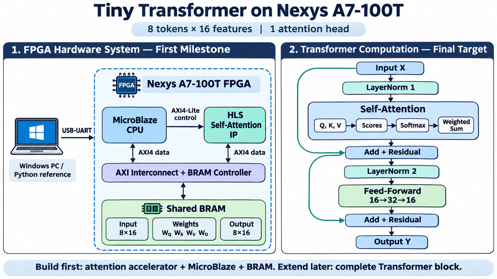

## Tiny Transformer FPGA Architecture



# Team A3 — 18 Checkpoints and Named Member Assignments

**Project:** Tiny Transformer Inference Engine on Nexys A7-100T (`xc7a100tcsg324-1`)  
**Final tools:** Vitis HLS C++ + Vivado 2025.1 + Vitis IDE for MicroBlaze  
**Members:** Md Mostafizur Rahman, Deepak, Turja  
**Duration:** 4 weeks · 18 checkpoints

**Checkpoint names are copied exactly from the `Checkpoint: what exactly to do` column of `Weekly_Updates.xlsx`.** Do not rename, reword or renumber them. `Main lead` is the formal Excel owner, while `Named member responsibilities` explains who produces each part.

## Week 1 — Setup, Python Reference and Attention Calculations

Finalize reference vectors, tests and attention mathematics.

| ID | Exact checkpoint name | Main lead | Named member responsibilities |
|---:|---|---|---|
| 1 | Set up GitHub and confirm Nexys A7 / Vivado / Vitis tools | Mostafizur | **Mostafizur:** create repository, branches, and tool/board setup instructions. **Deepak and Turja:** confirm their local tool access. |
| 2 | Agree on the 8-token, 16-feature, one-head model and test data | All | **Mostafizur:** fix hardware configuration. **Turja:** prepare shared input/weight data. **Deepak:** review attention dimensions. |
| 3 | Run the full Python/NumPy reference model and tests | Mostafizur | **Turja:** execute and maintain Python reference tests. **Mostafizur:** review results and capture evidence. |
| 4 | Verify Q, K, V projections and Q × K transpose scores | Mostafizur | **Deepak:** calculate and check Q/K/V projections and score matrices. **Mostafizur:** verify the results. |
| 5 | Verify Softmax and weighted-sum attention results | Mostafizur | **Deepak:** check Softmax and attention-weighted sum. **Turja:** provide golden outputs. **Mostafizur:** sign off on comparisons. |

## Week 2 — Vitis HLS and Vivado Architecture

Verify and synthesize the attention accelerator, begin AXI/MicroBlaze integration.

| ID | Exact checkpoint name | Main lead | Named member responsibilities |
|---:|---|---|---|
| 6 | Run attention C simulation in Vitis HLS | Mostafizur | **Mostafizur:** run HLS C simulation. **Deepak:** prepare attention test cases. **Turja:** supply expected outputs. |
| 7 | Synthesize attention hardware and export the HLS IP | Mostafizur | **Mostafizur:** run HLS synthesis, inspect reports, and export IP. **Deepak:** review attention logic and verification logs. |
| 8 | Build MicroBlaze, AXI BRAM, clock, reset and UART in Vivado | Mostafizur | **Mostafizur:** create and validate the complete MicroBlaze block design. |
| 9 | Connect Transformer IP to AXI and validate the complete design | Mostafizur | **Mostafizur:** connect AXI/BRAM interfaces and address map. **Deepak:** check accelerator interface behavior. |
| 10 | Verify LayerNorm, residual connections and the 16–32–16 FFN | Mostafizur | **Turja:** implement/test the reference support functions. **Deepak:** check corner cases. **Mostafizur:** review HLS integration requirements. |

## Week 3 — Nexys A7 Testing and Transformer Integration

Build the board system and verify FPGA output against the reference.

| ID | Exact checkpoint name | Main lead | Named member responsibilities |
|---:|---|---|---|
| 11 | Generate the Vivado bitstream and matching Vitis platform | Mostafizur | **Mostafizur:** implement the design, meet timing where feasible, export XSA, and create the Vitis platform. |
| 12 | Write MicroBlaze code to load data, start IP and read output | Mostafizur | **Mostafizur:** write the MicroBlaze application and capture UART output. |
| 13 | Test attention on the Nexys A7 and compare against Python | Mostafizur | **Mostafizur:** run FPGA board tests. **Deepak:** debug attention discrepancies. **Turja:** compute the numerical error table. |
| 14 | Integrate the full Transformer in C++ and test HLS feasibility | Mostafizur | **Mostafizur:** integrate and test the full HLS top level. **Deepak:** supply attention core. **Turja:** supply LayerNorm/FFN reference behavior. |

## Week 4 — Optimization, Benchmarks and Final Delivery

Check fixed-point feasibility, resource use, measurements and final evidence.

| ID | Exact checkpoint name | Main lead | Named member responsibilities |
|---:|---|---|---|
| 15 | Evaluate INT8/fixed-point attention with Python golden outputs | Mostafizur | **Deepak:** test quantized attention calculations. **Turja:** generate golden comparisons. **Mostafizur:** evaluate accelerator compatibility and accuracy. |
| 16 | Synthesize optimized hardware or document resource limits | Mostafizur | **Mostafizur:** run optimized synthesis and record resources/timing or blockers. **Deepak:** check attention correctness after optimization. |
| 17 | Measure CPU and FPGA latency and compare the results | Mostafizur | **Mostafizur:** run and report CPU/FPGA timing. **Turja:** compare numerical accuracy. **Deepak:** independently review test repeatability. |
| 18 | Finish GitHub README, report, slides and board demonstration | All | **Turja:** README, report, and slides. **Mostafizur:** Nexys A7 demonstration and benchmark evidence. **Deepak:** attention verification evidence and results. |

## Overall team responsibilities

| Member | Primary technical work | Expected deliverable |
|---|---|---|
| **Md Mostafizur Rahman** | Vitis HLS top-level, Vivado MicroBlaze/AXI BRAM integration, implementation, FPGA verification, resource and latency benchmarking | Working attention hardware demo with real FPGA evidence and measurements |
| **Deepak** | Q/K/V projections, attention scores, Softmax, weighted sum, numerical checks and quantization support | Verified attention arithmetic, test cases and correctness evidence |
| **Turja** | Python/NumPy reference, LayerNorm, 16–32–16 FFN, residual paths, golden outputs, documentation | Reference outputs, Transformer support tests, comparison tables, README/report/slides |

The Excel formal `Main lead` is **Mostafizur** for checkpoints 1 and 3–17, and **All** for checkpoints 2 and 18. Contributions by the other members remain explicit above. Everyone records work in their own status column.

## Recording actual progress

1. Open `tracking/Weekly_Updates.xlsx` → **Weekly Checkpoints**.
2. Use the same ID and exact title shown in this README.
3. Update only your own column using `Not started`, `In progress`, `I did it`, `I did it with teammate`, or `I failed to do it`.
4. For joint work, record the collaborator in **Teammate Details**.
5. Add proof in the relevant `weekly_work/week_0N/<member>/` folder. For hardware checkpoints, proof means an actual report, verified bitstream/XSA, board output or measured result—not merely source files.

**Tracker snapshot (24 November 2026):** IDs 1 and 2 marked done by Mostafizur; ID 4 in progress; remaining checkpoints open. Do not automatically mark work complete because the host reference tests pass.

## GitHub project folders

```text
Team_A3_Tiny_Transformer_NEXYS_A7/
  README.md
  hls/                # C++ HLS attention and Transformer source
  reference/          # Python/NumPy golden model
  data/               # Deterministic input, weights and outputs
  scripts/            # Host tests, HLS flow and checkpoint sync check
  integration/        # Vivado + MicroBlaze integration notes
  tracking/           # Weekly_Updates.xlsx + CHECKPOINTS_18.md
  weekly_work/
    week_01/{mostafizur,deepak,turja}/
    week_02/{mostafizur,deepak,turja}/
    week_03/{mostafizur,deepak,turja}/
    week_04/{mostafizur,deepak,turja}/
  docs/               # Architecture and final report evidence
```

To check that the repository's Excel, Markdown plan and weekly README titles are synchronized exactly, run `python3 scripts/check_checkpoint_sync.py` from the repository root.

**Scope:** The first FPGA milestone is a working 8-token × 16-feature attention accelerator; a full FP32 Transformer that fits and meets timing on Nexys A7 is a feasibility extension, not a completed result.
